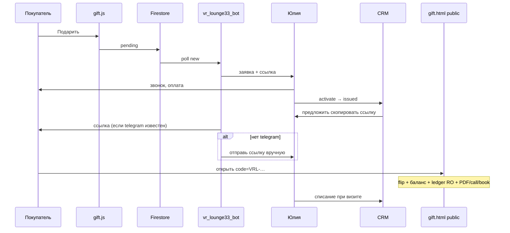

# Gift Card ↔ CRM — Source of Truth (синхронизация)

**Статус реализации:** **DELIVERY live** (2026-11-09): публичная премиум-страница по `publicCode`, CRM «ссылка клиенту» + PDF, бот `@vr_lounge33_bot` доставляет ссылку после activate.  
**Дата:** 2026-11-09  
**Владелец продукта / HITL:** Юлия (оплата, выпуск, связь с покупателем)  
**Экономика (P0):** одна CRM, ручной выпуск после оплаты — нет эквайринга в v1; операционная стоимость ≈ 8–12 мин на заявку (звонок + карта + ссылка). Без платных новых сервисов (reuse Firebase + Telegram + Pages).

---

## 0. Связь с облаком / Grok (факт, 2026-11-09)

| Вопрос | Вердикт |
|--------|---------|
| Живой API-коннект к облачному агенту / Grok | **Нет** (sync через бриф + GitHub + сообщение в Grok) |
| Grok Bot.app «VR-клуб Кольчугино» | **Да** — канон + контур выдачи |
| GitHub `VR-Lounge/vr-lounge-redesign` | **Да** — публичная `gift.html` |
| CRM `VR-Lounge/-` | **Да** — gift UI + redirect `gift.html` |
| Telegram Functions (Blaze) | **Обход:** Render polling `telegram-bot.js` |
| Прод vr-lounge.ru кнопки | **HITL** отдельно; github.io ок для выдачи |

---

## 1. Канонические пути и URL

| Артефакт | Путь / URL |
|----------|------------|
| **CRM (код)** | `/Users/LOBANOFF-PRO/Documents/VR Lounge/CRM VR Lounge` |
| **CRM (live Pages)** | https://vr-lounge.github.io/-/ |
| **Редизайн (клон)** | `/Users/LOBANOFF-PRO/Documents/VR Lounge/vr-lounge-redesign` |
| **Редизайн live** | https://vr-lounge.github.io/vr-lounge-redesign/ |
| **Превью gift popup** | https://vr-lounge.github.io/vr-lounge-redesign/?autogift=1 |
| **Публичная карта (канон выдачи)** | https://vr-lounge.github.io/vr-lounge-redesign/gift.html?code=VRL-XXXXXX |
| **Печать PDF** | `…/gift.html?code=VRL-XXXXXX&print=1` |
| **Бот** | `@vr_lounge33_bot` |
| **Firebase** | `vr-lounge33` |
| **Репо redesign** | `VR-Lounge/vr-lounge-redesign` |
| **Репо CRM** | `VR-Lounge/-` |

**Правило:** вторая CRM / отдельная БД — **запрещены**. Клиенту отдаём **ссылку** на премиум-страницу, не «PDF из воздуха» как единственный артефакт.

---

## 2. Канон UX выдачи

### 2.1 Публичная страница (клиент)
- Уникальный URL по `publicCode` (capability URL; чужие карты не перечисляются UI).
- Визуал redesign: `.vrl-gift` 3D flip, номинал/имя/номер, баланс, ledger read-only.
- CTA: PDF (print), позвонить, записаться (WhatsApp). Без ссылки в админку CRM.
- **Списание с публички — НЕТ.**

### 2.2 CRM (Юлия)
- «Скопировать ссылку клиенту», «Скачать PDF/PNG», «Открыть страницу клиента».
- После **Оплачено / активировать** — диалог со ссылкой и копированием.
- Списание баланса — только в CRM.

### 2.3 Бот `@vr_lounge33_bot`
- Pending → notify админам.
- Issued (polling) → deliver ссылку клиенту по `buyerPhone` → `clients.telegramId`; иначе админу «отправь ссылку» + `/giftlink` + deep link `t.me/vr_lounge33_bot?start=gift_CODE`.
- Команда админа: `/giftlink VRL-XXXXXX`.

### 2.4 Popup сайта
- Номинал 1 000–20 000 ₽; телефон обязателен; имя опционально → `НЕ УКАЗАНО`.
- Submit → `pending` → HITL оплата → activate.

---

## 3. Модель данных

### `giftCards` (как раньше + delivery)
| Поле | Описание |
|------|----------|
| `publicCode` | `VRL-XXXXXX` |
| `faceValue` / `balance` | номинал / остаток |
| `buyerPhone` / `buyerPhoneDigits` | покупатель |
| `recipientName` | получатель |
| `status` | `pending` \| `issued` \| `partial` \| `redeemed` \| `void` (+ `draft`) |
| `deliveryNotifiedAt` | когда бот обработал выдачу ссылки |
| `deliveryChannel` | `telegram` \| `admin_manual` |
| `deliveryTelegramId` | chat id, если отправили |

### `giftLedger`
Кредит при activate / дебет при списании (CRM auth). Публичка — только read.

**Безопасность:** UI публички грузит **одну** карту по `code`. Списание/update с клиента — запрещены rules (`update` только auth). Полный list без auth теоретически возможен на уровне rules (`read: if true`) — mitigations: длинный код + noindex + UI не листит; ужесточение list→auth = отдельный HITL (потребует doc-id=code или CF).

---

## 4. Файлы реализации

**CRM**
- `gift-cards.js` — CRM UI + API; `publicPageUrl` → redesign
- `gift.html` — redirect на redesign public page
- `telegram-bot.js` — pending notify + delivery listener + `/giftlink`
- `firestore.rules` — giftCards/giftLedger
- `GIFT_CARD_OPERATOR_RUNBOOK.md`, `GROK_CLOUD_SYNC_BRIEF.md`

**Редизайн**
- `gift.html` + `css/gift-page.css` + `js/gift-page.js` — премиум выдача
- `css/vrl-gift.css`, `js/gift.js` — flip UI сайта
- `js/gift-cards.js` — shared API

---

## 5. Поток E2E (выдача)

---

## 6. Статус DoD

- [x] Схема + rules deployed
- [x] Gift submit → Firestore
- [x] Telegram notify (Render bot)
- [x] CRM: pending / activate / redeem / void
- [x] Публичная премиум-страница (flip, баланс, ledger, CTA, PDF)
- [x] CRM: скопировать ссылку + PDF + offer после activate
- [x] Бот: delivery после activate + `/giftlink`
- [x] Безопасность: RO публичка, списание только CRM
- [ ] Chrome E2E после Pages push (этот цикл)
- [ ] Кнопки на прод vr-lounge.ru (HITL)

---

## 7. Kill-criteria

- Второе хранилище без синка с Firestore  
- Success без документа в `giftCards`  
- Нет Telegram 24 ч после релиза при тестовой заявке  
- Учёт только в Excel >3 дней  
- Выдача клиенту «только PDF без уникальной ссылки» как единственный канал  

---

## 8. HITL / следующий шаг

1. Push Pages redesign + CRM (мандат delivery — можно).  
2. Рестарт Render-бота с новым `telegram-bot.js`.  
3. Прод vr-lounge.ru — только явное ок.  
4. Деньги / OTP — не трогать.
