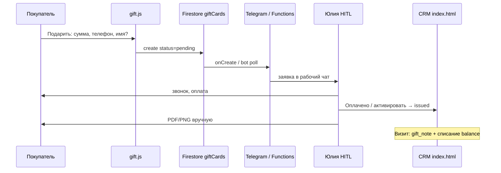

# Gift Card ↔ CRM — Source of Truth (синхронизация)

**Статус реализации:** **DONE live** (2026-11-09): rules deployed, CRM+redesign Pages pushed, E2E create/activate/redeem verified. Остаток: Telegram Functions (нужен Blaze) → обход Render-бот / HITL CRM; прод vr-lounge.ru кнопки — отдельный HITL  
**Дата:** 2026-11-09  
**Владелец продукта / HITL:** Юлия (оплата, выпуск PDF/PNG, связь с покупателем)  
**Экономика (P0):** одна CRM, ручной выпуск карты после оплаты — нет эквайринга в v1; операционная стоимость ≈ 10–15 мин на заявку (звонок + карта), маржа сохраняется за счёт отсутствия комиссии платёжного шлюза. Без платных новых сервисов (reuse Firebase + Telegram).

---

## 0. Связь с облаком / Grok (факт, 2026-11-09 ~18:00)

| Вопрос | Вердикт |
|--------|---------|
| Живой API-коннект к облачному агенту `bc-4ee4…` / Grok | **Нет** (sync через бриф + GitHub) |
| Grok Bot.app «VR-клуб Кольчугино» | **Да** — найден; sync-бриф принят (см. `GROK_CLOUD_SYNC_BRIEF.md`) |
| Cursor Origin репозиторий redesign | **Нет** (namespace `vr-lounge` пуст) |
| GitHub `VR-Lounge/vr-lounge-redesign` | **Да** — клон: `/Users/LOBANOFF-PRO/Documents/VR Lounge/vr-lounge-redesign` |
| Облачные ветки Cursor Cloud | **Да**: `gift-card-preview-e6c6` **влит в main** (PR #4); `gift-crm-integrate-e6c6` **не в main** (патчи в локальной CRM) |
| CRM `VR-Lounge/-` push из облака | Облако получило **403**; патчи `crm-patches/` — **применены локально** сюда |

**Итог:** канон **согласован** с Grok; код UI в GitHub main; CRM-интеграция локально готова; prod deploy = HITL.

---

## 1. Канонические пути и URL

| Артефакт | Путь / URL |
|----------|------------|
| **CRM (код, локально)** | `/Users/LOBANOFF-PRO/Documents/VR Lounge/CRM VR Lounge` |
| **CRM (live, GitHub Pages)** | https://vr-lounge.github.io/-/ |
| **Редизайн (клон)** | `/Users/LOBANOFF-PRO/Documents/VR Lounge/vr-lounge-redesign` |
| **Редизайн live** | https://vr-lounge.github.io/vr-lounge-redesign/ |
| **Превью gift popup** | https://vr-lounge.github.io/vr-lounge-redesign/?autogift=1 |
| **Публичная карта** | https://vr-lounge.github.io/vr-lounge-redesign/gift.html?code=VRL-XXXXXX |
| **Прод-сайт (целевой хост)** | https://vr-lounge.ru/ |
| **Firebase проект** | `vr-lounge33` |
| **Репозиторий редизайна** | `VR-Lounge/vr-lounge-redesign` |
| **Репозиторий CRM** | `VR-Lounge/-` |
| **Облачный агент (reference)** | `bc-4ee4d687-0d2b-58cf-aa0e-c8437b0ae6c6`, env `gift-card-preview-e6c6` |

**Правило:** вторая CRM / отдельная БД / параллельный модуль вне Firestore `vr-lounge33` **запрещены**. Standalone `crm-gift/` на redesign — только временный артефакт облака; канон UI — секция в `index.html` CRM.

---

## 2. Канон UX

### 2.1 Визуал карты
- Горизонтальная цифровая карта; `.vrl-gift`, `css/gift.css`, `css/vrl-gift.css`, `js/gift.js`.

### 2.2 Точки входа
1. **Поиграть** / **День рождения** — booking  
2. **Подарить** — `#btn-gift-open` → `#gift-bs`

### 2.3 Popup
- Номинал **1 000–20 000 ₽**, шаг **1 000**  
- Телефон обязателен; имя получателя **опционально** (пусто → `НЕ УКАЗАНО`)  
- Submit → Firestore `giftCards` (`status: pending`) → Telegram work chat → HITL Юлия → оплата → в CRM «Оплачено / активировать» → PDF/PNG вручную → списание баланса в CRM  

### 2.4 Демо
- `?giftDemo=1` — явный демо-режим без записи  
- Без demo: при ошибке Firestore — **честная ошибка** (без localStorage-success)

---

## 3. Модель данных (реализовано)

Коллекции в **`vr-lounge33`**:

### `giftCards`
| Поле | Тип | Описание |
|------|-----|----------|
| `publicCode` | string | Человекочитаемый код (`VRL-XXXXXX`) ≈ SoT `cardNumber` |
| `faceValue` | number | Номинал (= SoT `amountInitial`) |
| `balance` | number | Остаток (= SoT `balanceRemaining`) |
| `buyerPhone` / `buyerPhoneDigits` | string | Покупатель |
| `recipientName` | string | Получатель или `НЕ УКАЗАНО` |
| `status` | enum | `pending` \| `issued` \| `partial` \| `redeemed` \| `void` (+ `draft`) |
| `createdAt` / `paidAt` / `issuedAt` | timestamp | Жизненный цикл |
| `source` | string | `website-redesign` |
| `createdBy` | string | `site` / `crm` / uid |
| `type` | string | `gift` (prepaid reserved) |
| `currency` | string | `RUB` |
| `theme` | string | `amethyst` \| `silver` |

Маппинг SoT → факт: `pending_payment`→`pending`, `active`→`issued`, `depleted`→`redeemed`, `cancelled`→`void`.

### `giftLedger`
Кредит при создании / дебет при списании (CRM auth).

---

## 4. Файлы реализации

**CRM (`CRM VR Lounge`)**
- `firestore.rules` — `giftCards` + `giftLedger` (черновик; **deploy HITL**)
- `gift-cards.js` — UI-модуль: список, выпуск, «Оплачено», списание, void, booking hook
- `gift.html` — публичная страница карты (копия для CRM Pages)
- `index.html` — nav «Подарочные карты» + секция + init + gift_note в записи
- `telegram-bot.js` — `setupNewGiftCardListener()` (polling, как bookings)
- `functions/index.js` — `exports.onNewGiftCard` (deploy HITL)

**Редизайн (`vr-lounge-redesign`)**
- `js/gift.js` — реальный submit → Firestore (не demo)
- `js/gift-cards.js` — shared create/redeem API
- `gift.html` — публичный баланс / print

---

## 5. Поток E2E

---

## 6. Статус DoD

- [x] Схема + rules (черновик в репо)
- [x] Gift submit → Firestore (код; нужен deploy rules)
- [x] Telegram notify (bot listener + Function код)
- [x] CRM секция: pending / activate / redeem / void
- [x] Deploy rules + Pages CRM + redesign
- [x] E2E pending→issued→partial (списание) + кнопка PDF/PNG (print=1)
- [x] Native form live: `?autogift=1` → `VRL-BJS434` pending (Chrome DevTools, 0 critical console errors)
- [ ] Кнопки на прод-хосте vr-lounge.ru (отдельный HITL)

---

## 7. Kill-criteria (без изменений по смыслу)

- Второе хранилище без синка с Firestore  
- Success без документа в `giftCards`  
- Нет Telegram 24 ч после релиза при тестовой заявке  
- Учёт только в Excel >3 дней  
- >21 день без первой оплаченной карты на проде  

---

## 8. HITL — следующий шаг (P0)

1. **Deploy Firestore rules** (`firebase deploy --only firestore:rules`) — ок Александра  
2. Push CRM `gift-cards.js` + `index.html` + `gift.html` на `VR-Lounge/-` (Pages)  
3. Push redesign `js/gift.js` + `js/gift-cards.js` + `gift.html` на `main` redesign Pages  
4. Рестарт Render-бота **или** deploy `onNewGiftCard`  
5. Тест: `?autogift=1` → заявка → Telegram → CRM activate  

*Не деплоить в prod без явного ок.*
